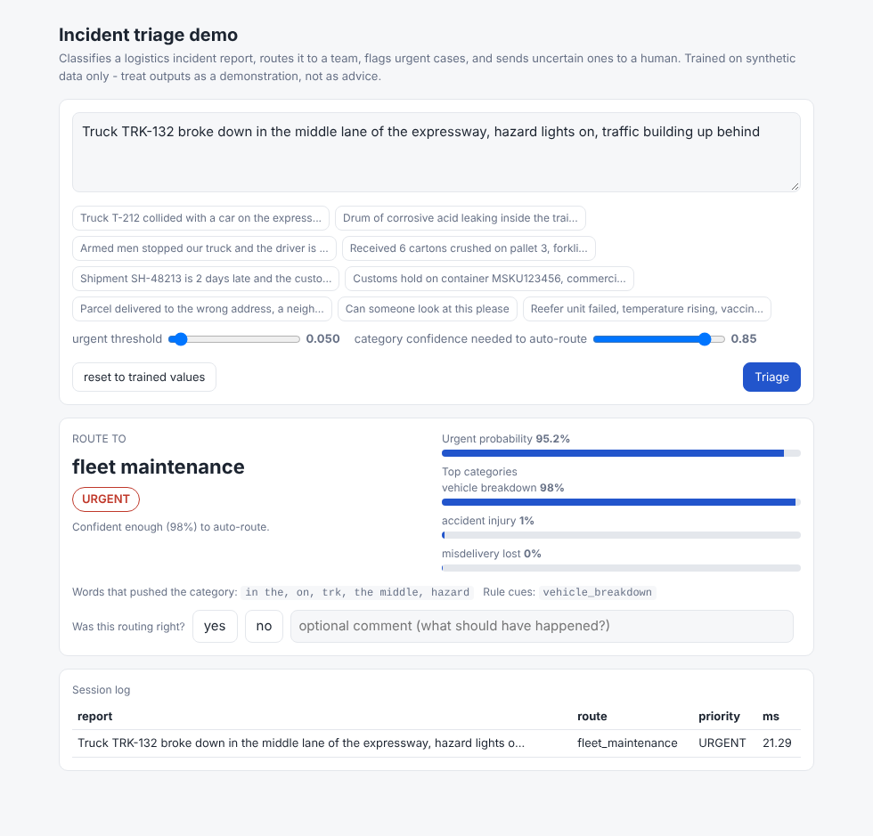

# Incident triage for a logistics operator

Classifies free-text incident reports into 9 categories, routes them to a team, flags **urgent** cases, and sends uncertain ones to a human. Compares a keyword-rules baseline with two ML variants on cost-weighted quality (costly misroutes), latency and cost, and shows how the system adapts to a stricter urgent-miss penalty and to a new category.

> **Read this first.** All data is synthetic and template-based, labels and costs are the author's assumptions, and the two things the brief asks a *person* to do - independent label review and demo feedback - are **not done yet** (tooling provided). Results bracket real performance; they do not predict it. See `BUSINESS_SUMMARY.md`.



## Quick start

```bash
pip install -r requirements.txt
make all        # data -> evaluate -> change-request experiments -> train -> tests (~12 min, 2 CPU cores)
make demo       # trains, then serves http://localhost:8000
```
Or step by step: `python -m triage.data_gen`, `python -m triage.evaluate`, `python -m triage.change_request`, `python -m triage.train`, `python demo/server.py 8000`.
CLI: `python -m triage.cli "driver is bleeding after a collision"` or `--file reports.csv --out triaged.csv`. Tests: `make test`.

## What is in the repo

| path | what |
|---|---|
| `BUSINESS_SUMMARY.md` | one-page summary for the client |
| `data/` | `incidents.csv` (900 synthetic reports), cold-chain extension (120), `DATA_PROVENANCE.md`, `DATASET_STATS.md`, blind review sheet + instructions |
| `docs/LABELING_GUIDE.md` | what category / urgent mean; ambiguous cases |
| `triage/` | generator, rules baseline, model + abstention policy, cost model (`config.py`), evaluation, experiments, review tooling |
| `results/` | `RESULTS.md` (main comparison), `CHANGE_REQUEST.md`, `ERROR_SUMMARY.md`, raw JSON/CSV, every test-set error as CSV, figures |
| `docs/ERROR_ANALYSIS.md` | what goes wrong and when to abstain |
| `docs/MODEL_SELECTION.md` | what was seen when; disclosure of everything that could bias the numbers |
| `demo/` | zero-dependency web demo with yes/no feedback buttons |
| `ATTRIBUTION.md`, `FEEDBACK.md` | people and AI tools; feedback template (empty) |

## Approaches compared

- **A** keyword rules with simple negation (no training; abstains when nothing fires)
- **B** TF-IDF + logistic regression (category head + urgent head), cost-tuned thresholds, confidence-based abstention
- **C** B + rule-hit features; **C+** C + urgent "safety net" (rules can only add URGENT flags). C+ is the demo model.

Cost model (`triage/config.py`, all invented): missed urgent 100, false urgent 5, wrong team 8 (25 if the true category is accident/hazmat/theft), human review 4, urgent report waiting unflagged in the review queue 10.

## Headline results (mean of 5 seeds; cost per 100 reports, lower is better)

| | random split | unseen-template split |
|---|---|---|
| human reads everything (best case / FIFO) | 400 / 617 | 400 / 617 |
| A rules | 726 | 880 |
| B tfidf-LR | 110 | 403 (abstains on 98%) |
| C + rule features | 111 | 424 |
| C+ + safety net | 117 | 417 (94% urgent recall, 48% abstain) |

Latency ~1-2 ms per report (single call, includes featurisation); CPU cost ~$0.00002 per 1,000 reports under a $0.05/vCPU-hour assumption; training 0.4-0.6 s. Details with bootstrap CIs: `results/RESULTS.md`.

Changed requirements (`results/CHANGE_REQUEST.md`): strict penalty (300) -> re-tune two thresholds in ~10 s, helps on hard data (574 -> 429), no effect on easy data; new category -> existing system abstains/misroutes it, ~40 labelled examples fix it if phrasing is familiar, far fewer than that is not enough, old categories unaffected.

## Status against the brief

| requirement | status |
|---|---|
| working demo | done (`demo/`, tested with curl and a headless browser) |
| dataset >= 300 reports, documented, non-confidential | done: 900 synthetic, `data/DATA_PROVENANCE.md` |
| **independent review of >= 50 labels** | **NOT done.** Blind 60-report sheet, instructions and scoring script are ready; needs a human who did not write the labels |
| >= 2 approaches, baseline, quality / latency / cost, error analysis, abstention | done |
| changed requirement | done (two scenarios) |
| GitHub repo | local git repo ready; **not published** (no GitHub credentials in the build environment) |
| one-page business summary | done |
| attribution of collaborators and AI tools | AI tool done; **names to fill in** in `ATTRIBUTION.md` |
| feedback from someone who tried the demo | **NOT done**; `FEEDBACK.md` has the protocol |

## Limitations

Synthetic, template-derived text (125 core sentences); one author for data, labels and rules; invented cost model; small test sets (a single missed urgent report moves cost by 35-55 points); no LLM or embedding model measured; the label-noise ceiling (~3%) caps measured accuracy; thresholds tuned on out-of-fold data from the same synthetic process.
