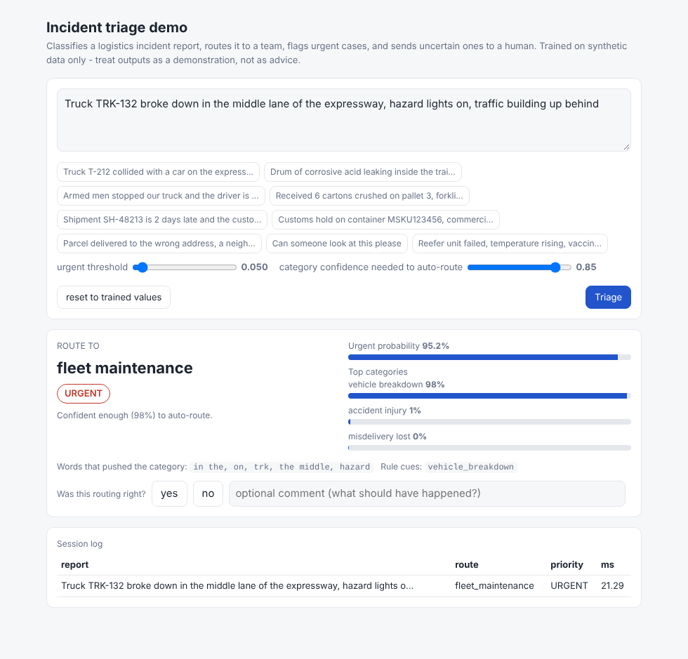

# Incident triage for a logistics operator

Classifies free-text incident reports into 9 categories, routes them to a team, flags **urgent** cases, and sends uncertain ones to a human. Compares a keyword-rules baseline with two ML variants on cost-weighted quality (costly misroutes), latency and cost, and shows how the system adapts to a stricter urgent-miss penalty and to a new category.

> **Read this first.** All data is synthetic and template-based, labels and costs are the author's assumptions, and the two things the brief asks a *person* to do - independent label review and demo feedback - were **done after submission** (14-20 Nov 2026; see "Checks done after submission" below). Results bracket real performance; they do not predict it. See `BUSINESS_SUMMARY.md`.



## Live demo

**Live demo: https://incident-triage-demo.onrender.com  (free hosting sleeps when idle; the first load can take about a minute while it wakes up)

To run it yourself: see Quick start below. To deploy your own copy: connect this repository to Render (it reads `render.yaml`) or build the `Dockerfile`; the server reads the `PORT` environment variable. The trained model (`models/triage_model.joblib`, ~1.4 MB) is committed so the host does not have to train it; if it is missing the server trains one on start-up (slow on a free instance).

## Quick start

```bash
pip install -r requirements.txt
make all        # data -> evaluate -> change-request experiments -> train -> tests (~12 min, 2 CPU cores)
make demo       # trains, then serves http://localhost:8000
```
Or step by step: `python -m triage.data_gen`, `python -m triage.evaluate`, `python -m triage.change_request`, `python -m triage.train`, `python demo/server.py 8000`.
CLI: `python -m triage.cli "driver is bleeding after a collision"` or `--file reports.csv --out triaged.csv`. Tests: `make test`.

## Collaboration and use of AI agents

- **AI agent:** Claude (Anthropic, Claude Sonnet 5.5) wrote essentially all of the code (`triage/`, `demo/`, `tests/`, the synthetic data generator), the first drafts of every document, and ran the experiments in `results/` through its file and shell tools in a single working session on 2026-10-26. The numbers in `results/` are the unedited output of the scripts in this repository. Full detail: `ATTRIBUTION.md`.
- **Me (project owner, Anandi Mehrotra):** I gave Claude the brief, directed it throughout and deployed the demo. I did not write the code by hand, and I did not verify the results before submitting: the checks below were done afterwards.
- **Other people:** Dhruv and Pranav, friends with no part in building the project, did the independent label review and tested the live demo after submission.
- **AI after submission:** Claude also helped me in a separate session (13-20 Nov): it made the review sheets, ran the penalty check below with me and drafted these updates.
- No real or confidential data was given to any AI tool; all data is synthetic.

## What is in the repo

| path | what |
|---|---|
| `BUSINESS_SUMMARY.md` | one-page summary for the client |
| `data/` | `incidents.csv` (900 synthetic reports), cold-chain extension (120), `DATA_PROVENANCE.md`, `DATASET_STATS.md`, blind review sheet + instructions |
| `docs/LABELING_GUIDE.md` | what category / urgent mean; ambiguous cases |
| `triage/` | generator, rules baseline, model + abstention policy, cost model (`config.py`), evaluation, experiments, review tooling |
| `results/` | `RESULTS.md` (main comparison), `CHANGE_REQUEST.md`, `ERROR_SUMMARY.md`, raw JSON/CSV, every test-set error as CSV, figures |
| `docs/ERROR_ANALYSIS.md` | what goes wrong and when to abstain |
| `docs/MODEL_SELECTION.md` | what was seen when; disclosure of everything that could bias the numbers |
| `demo/` | zero-dependency web demo with yes/no feedback buttons |
| `ATTRIBUTION.md`, `FEEDBACK.md` | people and AI tools; feedback template (empty) |

## Approaches compared

- **A** keyword rules with simple negation (no training; abstains when nothing fires)
- **B** TF-IDF + logistic regression (category head + urgent head), cost-tuned thresholds, confidence-based abstention
- **C** B + rule-hit features; **C+** C + urgent "safety net" (rules can only add URGENT flags). C+ is the demo model.

Cost model (`triage/config.py`, all invented): missed urgent 100, false urgent 5, wrong team 8 (25 if the true category is accident/hazmat/theft), human review 4, urgent report waiting unflagged in the review queue 10.

## Headline results (mean of 5 seeds; cost per 100 reports, lower is better)

| | random split | unseen-template split |
|---|---|---|
| human reads everything (best case / FIFO) | 400 / 617 | 400 / 617 |
| A rules | 726 | 880 |
| B tfidf-LR | 110 | 403 (abstains on 98%) |
| C + rule features | 111 | 424 |
| C+ + safety net | 117 | 417 (94% urgent recall, 48% abstain) |

Latency ~1-2 ms per report (single call, includes featurisation); CPU cost ~$0.00002 per 1,000 reports under a $0.05/vCPU-hour assumption; training 0.4-0.6 s. Details with bootstrap CIs: `results/RESULTS.md`.

Changed requirements (`results/CHANGE_REQUEST.md`): strict penalty (300) -> re-tune two thresholds in ~10 s, helps on hard data (574 -> 429), no effect on easy data; new category -> existing system abstains/misroutes it, ~40 labelled examples fix it if phrasing is familiar, far fewer than that is not enough, old categories unaffected.

## Status against the brief

| requirement | status |
|---|---|
| working demo | done (`demo/`, tested with curl and a headless browser); live link at the top of this README |
| dataset >= 300 reports, documented, non-confidential | done: 900 synthetic, `data/DATA_PROVENANCE.md` |
| independent review of >= 50 labels | done after submission (15-16 Nov 2026): 60 labels, 2 independent reviewers; `data/review/review_report_independent.md` |
| >= 2 approaches, baseline, quality / latency / cost, error analysis, abstention | done |
| changed requirement | done (two scenarios) |
| GitHub repo | this repository |
| one-page business summary | done |
| attribution of collaborators and AI tools | done (`ATTRIBUTION.md`) |
| feedback from someone who tried the demo | done after submission (14-16 Nov 2026): 2 testers; `FEEDBACK.md` |

## Checks done after submission (14-20 Nov 2026)

Done after the 26 Oct submission. Nothing in `results/` was changed.

| check | what it found |
|---|---|
| Independent label review | Dhruv and Pranav relabelled 60 reports (30 each) without seeing the recorded labels. Agreement with the recorded labels: category 53/60 (88.3%, Cohen's kappa 0.87), urgent 55/60 (91.7%, kappa 0.73). Of the 2 deliberately flipped labels in the sample, they caught 1. `data/review/review_report_independent.md` |
| My own blind relabel (not independent) | Same 60, done 14 Nov before I saw the labels: category 51/60 (85.0%, kappa 0.83), urgent 52/60 (86.7%, kappa 0.63). I caught the other flipped label, and marked 7 routine reports urgent that the labels did not. `data/review/review_report_mine.md` |
| Demo feedback | 2 testers, 5 reports each (`FEEDBACK.md`). "Forklift toppled operator is unresponsive" scored 6.5% urgent against the 5% cut-off: neither "toppled" nor "unresponsive" appears in the training data. |
| Reproduction | `python -m triage.evaluate`, re-run from a fresh clone, gives the same 5-run averages as `results/RESULTS.md`. |
| Penalty check | `python checks/penalty_check.py`. If a false URGENT flag on a report sent to a person cost 5 instead of 0, unseen-wording averages become B 580.9 and C+ 483.3 (as built: 402.8 and 416.6). Which model is cheaper depends on that assumption; that neither beats people reading everything (400) on unseen wording holds either way. |
| Safety net | In all 10 runs (5 seeds x 2 tests) approaches C and C+ miss exactly the same urgent reports (`results/results.json`), so the rules safety net caught nothing extra; it only adds false alarms, e.g. "import permit expired" is forced URGENT. |

## Limitations

Synthetic, template-derived text (125 core sentences); one author for data, labels and rules; invented cost model; small test sets (a single missed urgent report moves cost by 35-55 points); no LLM or embedding model measured; the label-noise ceiling (~3%) caps measured accuracy; thresholds tuned on out-of-fold data from the same synthetic process.
