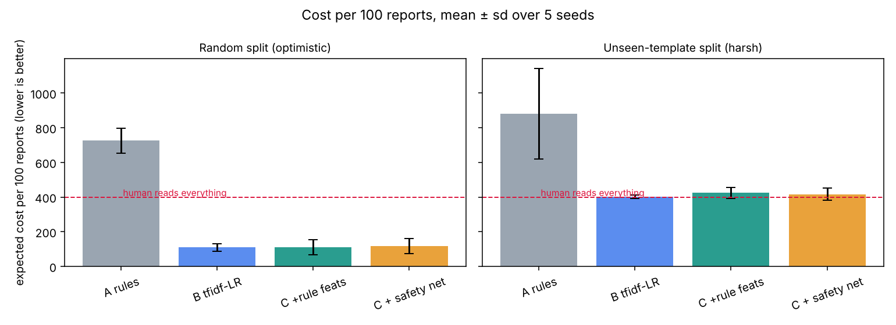

# Results (auto-generated by `python -m triage.evaluate` - do not edit by hand)

Cost units are ASSUMPTIONS, see `triage/config.py`: miss_urgent=100.0, false_urgent=5.0, wrong_team=8.0, wrong_team_critical=25.0, human_review=4.0, abstain_urgent_delay=10.0.

Human-reads-everything references: **400 per 100 reports** if the queue is perfectly prioritised and the human is always right (best case for the human), or **617** if reports are read first-in-first-out so urgent ones wait (urgent share 21.7%).

## Random stratified split (optimistic: test phrasings also seen in training)

Mean ± sd over 5 seeds; count columns are the mean per seed (test sets have ~180 / ~270 reports). `urgent missed` = truly urgent reports NOT flagged urgent (including ones sent to a human). `costly misroutes` = urgent reports auto-routed as standard + safety-critical reports auto-routed to the wrong team.

| approach | cost / 100 | abstain rate | urgent recall | urgent missed (count/seed) | costly misroutes (count/seed) | accuracy on auto-routed |
|---|---|---|---|---|---|---|
| A_rules_baseline | 725.7 ± 71.2 | 27.0% | 72.5% | 9.2 | 15.0 | 86.9% |
| B_tfidf_logreg | 109.7 ± 22.0 | 10.9% | 98.9% | 0.4 | 2.8 | 97.3% |
| C_tfidf_logreg_plus_rule_features | 111.4 ± 43.5 | 12.7% | 98.7% | 0.4 | 2.6 | 97.3% |
| C+_with_urgent_safety_net | 117.0 ± 42.3 | 12.7% | 98.7% | 0.4 | 2.6 | 97.3% |

### Seed 42 detail (random): n_test=180, urgent in test=39, injected label noise in test=1

| approach | cost / 100 [95% bootstrap CI] | thresholds (urgent, category) | median / p95 latency ms | CPU $ per 1,000 reports | fit s | model KB |
|---|---|---|---|---|---|---|
| A_rules_baseline | 634.4 [380.6, 930.7] | - | 0.06 / 0.10 | 0.000001 | 0.00 | 0 |
| B_tfidf_logreg | 140.0 [44.4, 309.0] | 0.20, 0.35 | 1.62 / 1.90 | 0.000022 | 0.46 | 1244 |
| C_tfidf_logreg_plus_rule_features | 75.0 [44.4, 110.0] | 0.15, 0.60 | 1.28 / 1.55 | 0.000018 | 0.59 | 1245 |
| C+_with_urgent_safety_net | 80.6 [47.8, 116.7] | 0.15, 0.60 | 1.47 / 2.26 | 0.000022 | 0.57 | 1245 |

Category-confidence calibration (ECE) of approach C: 0.060

Event counts on the test set (seed 42): 
- A_rules_baseline: {"review": 49, "wrong_team": 12, "false_urgent": 3, "wrong_team_critical": 5, "missed_urgent": 7, "abstain_urgent_delay": 1}
- B_tfidf_logreg: {"review": 19, "false_urgent": 2, "wrong_team_critical": 2, "wrong_team": 2, "missed_urgent": 1}
- C_tfidf_logreg_plus_rule_features: {"false_urgent": 2, "review": 23, "wrong_team_critical": 1, "wrong_team": 1}
- C+_with_urgent_safety_net: {"false_urgent": 4, "review": 23, "wrong_team_critical": 1, "wrong_team": 1}

## Unseen-template split (harsh: core phrasing of test reports never seen in training)

Mean ± sd over 5 seeds; count columns are the mean per seed (test sets have ~180 / ~270 reports). `urgent missed` = truly urgent reports NOT flagged urgent (including ones sent to a human). `costly misroutes` = urgent reports auto-routed as standard + safety-critical reports auto-routed to the wrong team.

| approach | cost / 100 | abstain rate | urgent recall | urgent missed (count/seed) | costly misroutes (count/seed) | accuracy on auto-routed |
|---|---|---|---|---|---|---|
| A_rules_baseline | 880.1 ± 262.3 | 26.4% | 66.0% | 18.8 | 26.4 | 85.7% |
| B_tfidf_logreg | 402.8 ± 10.5 | 98.2% | 99.6% | 0.2 | 0.2 | 45.0% |
| C_tfidf_logreg_plus_rule_features | 424.1 ± 31.5 | 46.2% | 93.8% | 3.4 | 8.6 | 88.9% |
| C+_with_urgent_safety_net | 416.6 ± 34.5 | 48.4% | 93.8% | 3.4 | 7.0 | 90.1% |

### Seed 42 detail (template): n_test=274, urgent in test=51, injected label noise in test=5

| approach | cost / 100 [95% bootstrap CI] | thresholds (urgent, category) | median / p95 latency ms | CPU $ per 1,000 reports | fit s | model KB |
|---|---|---|---|---|---|---|
| A_rules_baseline | 595.6 [405.1, 828.5] | - | 0.06 / 0.09 | 0.000001 | 0.00 | 0 |
| B_tfidf_logreg | 402.9 [397.1, 408.8] | 0.15, 0.55 | 1.09 / 1.41 | 0.000016 | 0.34 | 1050 |
| C_tfidf_logreg_plus_rule_features | 425.9 [317.9, 562.4] | 0.15, 0.55 | 1.31 / 1.62 | 0.000019 | 0.47 | 1050 |
| C+_with_urgent_safety_net | 388.3 [292.0, 517.9] | 0.10, 0.75 | 1.40 / 1.93 | 0.000020 | 0.51 | 1050 |

Category-confidence calibration (ECE) of approach C: 0.109

Event counts on the test set (seed 42): 
- A_rules_baseline: {"wrong_team": 8, "review": 97, "wrong_team_critical": 14, "missed_urgent": 8, "abstain_urgent_delay": 3}
- B_tfidf_logreg: {"review": 270, "wrong_team": 3}
- C_tfidf_logreg_plus_rule_features: {"wrong_team": 7, "wrong_team_critical": 16, "review": 104, "false_urgent": 13, "missed_urgent": 2, "abstain_urgent_delay": 3}
- C+_with_urgent_safety_net: {"review": 135, "false_urgent": 14, "missed_urgent": 2, "wrong_team": 3, "wrong_team_critical": 8, "abstain_urgent_delay": 3}

